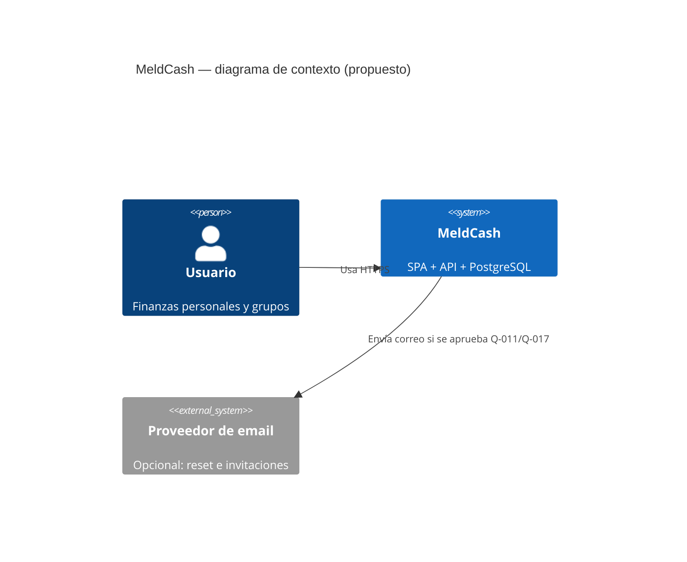
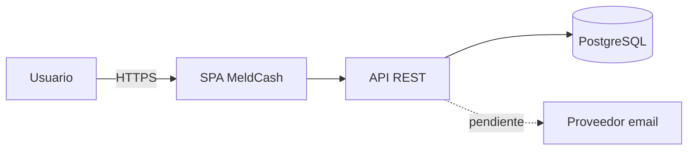
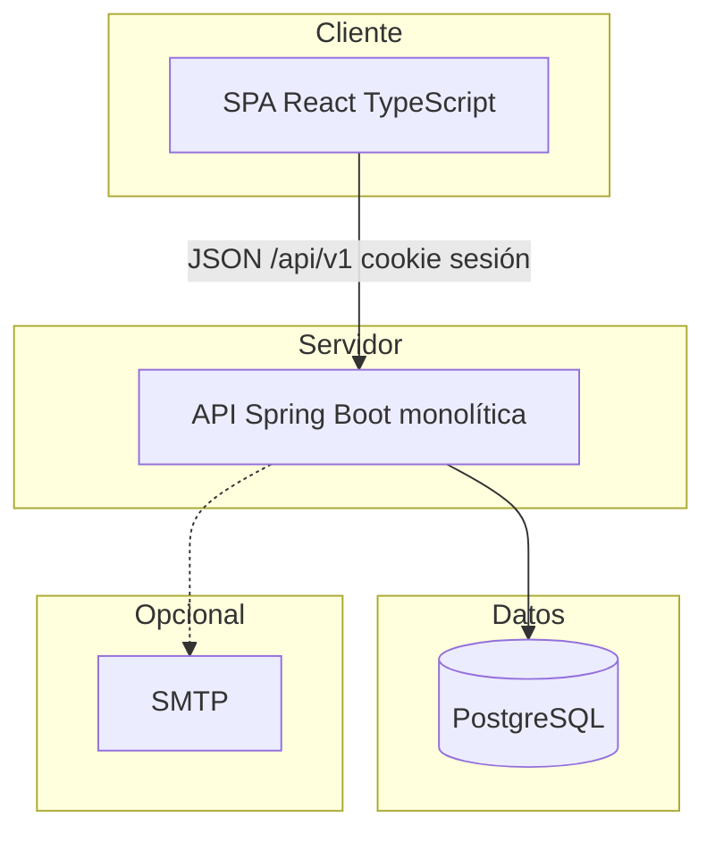
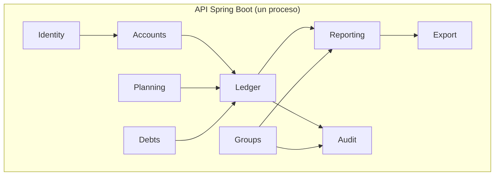
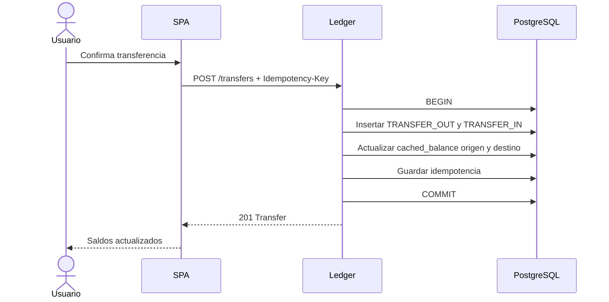
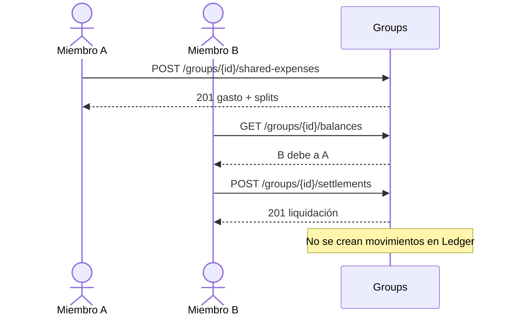
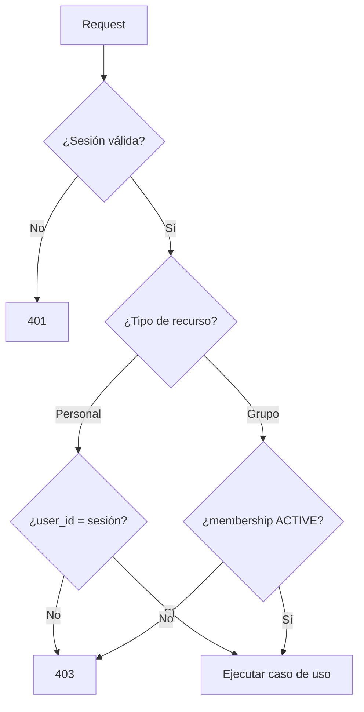

# Diagramas

**Estado:** propuestos. Sintaxis Mermaid para renderizar en visores compatibles.

## Contexto del sistema (C4-1)

Si el render C4 no está disponible:

## Contenedores (C4-2)

## Componentes de la API

`Groups` no depende de `Ledger` en el MVP (DEC-009, Q-002).

## Flujo: transferencia entre cuentas

## Flujo: gasto compartido y liquidación

## Autorización

