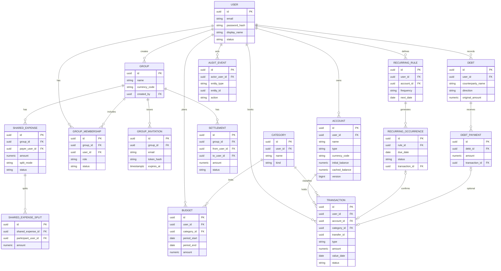

# Diagrama entidad-relación

**Estado:** propuesto, alineado con [data-model.md](data-model.md).



## Lectura de balances de grupo (no es tabla)

Para el par (A, B) en un grupo:

```text
owed_B_to_A =
    sum(split_B) for expenses posted where payer = A
  - sum(split_A) for expenses posted where payer = B
  + sum(settlements posted from B to A)
  - sum(settlements posted from A to B)
```

`owed_A_to_B = - owed_B_to_A`.
