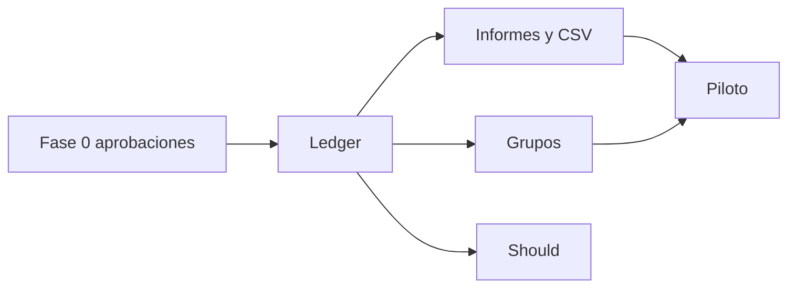

# Hoja de ruta del MVP

**Estado:** **propuesta**. Sin fechas ni horas-persona: no hay datos de equipo, disponibilidad ni velocidad.

## Objetivo de validación (propuesto)

Comprobar con usuarios piloto que pueden:

1. Llevar un libro personal de ingresos, gastos y transferencias sin distorsión.
2. Resolver un gasto compartido familiar (reparto + liquidación) sin duplicar el gasto.
3. Distinguir visualmente espacio personal y de grupo.
4. Llevarse un CSV personal.

Método de recogida de feedback: Q-021.

## Fases de trabajo (secuenciales lógicas)

### Fase 0 — Aprobaciones

Salida: alcance MoSCoW firmado, DEC-001, respuestas a preguntas bloqueantes (lista en open-questions.md).

**No hay código.**

### Fase 1 — Cimientos

Identidad, cuentas, ledger (ingreso/gasto/transfer/void), categorías, tests de integridad y IDOR.

**Criterio de salida:** TS-001, TS-002, TS-003, TS-011, TS-012 en automatizado de API.

### Fase 2 — Comprensión personal

Dashboard/summary, filtros, export CSV.

**Salida:** TS-007, TS-010 (parte personal).

### Fase 3 — Grupos

Grupos, membresía, invitaciones (según Q-017), shared expenses, balances, settlements.

**Salida:** TS-004, TS-005, TS-006.

### Fase 4 — Should si el piloto lo requiere

Presupuestos, recurrentes, deudas. Cada uno independiente.

### Fase 5 — Piloto cerrado

HTTPS, backups mínimos, UX adaptable, recolección de feedback. Aún no es “producto público”.

## Dependencias entre fases

Grupos no dependen de informes personales, sí de identidad.

## Criterios de aceptación del MVP (propuestos)

- Flujos Must de `scope.md` demostrables en un entorno piloto.
- Ningún Must mezcla gasto compartido en totales personales.
- Transferencias excluidas de ingreso/gasto.
- Autorización horizontal cubierta por pruebas automatizadas.
- Documentación de API alineada con lo construido (se actualizará **después**, no ahora).
- Lista de Won't respetada.

## Funcionalidades explícitamente fuera del MVP

Ver Won't en [scope.md](../product/scope.md): open banking, intereses, FX, Excel/PDF, metas, cuentas conjuntas, nativo, microservicios, cierre contable, adjuntos.

## Decisiones necesarias antes de implementar

1. Aprobar o corregir MoSCoW.
2. Aprobar DEC-001 o elegir alternativa.
3. Cerrar Q-001, Q-002, Q-007, Q-011, Q-014, Q-017, Q-018.
4. Autorizar la creación de un repositorio de código (este es documental).
5. Definir quién opera SMTP, DNS y hosting.

## Qué no incluye esta hoja

Calendario, presupuesto, headcount, OKRs comerciales.
